# Simulation results: STM32 synchronous-buck MPPT charger

*Written 2026-11-11. Everything below is **simulated**, not measured. Nothing here has been checked on hardware; there is no bench data in `bench/` yet.*

This document covers three layers of simulation:

1. **LTspice v1.5 / v1.6 / v1.7**: switching-level model of the power stage. Static duty sweep at the hardware frequency (100 kHz), with the PV-input Schottky and a 14.4 V battery case. v1.6 is v1.5 with the Infineon IRF3205 vendor model in place of the IRFZ44N placeholder. v1.7 adds IR2110 driver timing and gate resistors to check the dead-time margin.
2. **Firmware logic**: `firmware/mppt_po.c` (Perturb & Observe) and `firmware/charger_fsm.c` (charge state machine). Written in bare-metal style (float32, no HAL, no heap) and compiled for the Cortex-M4F.
3. **Software-in-the-loop (SIL)**: the *same C files* built as a host DLL and driven from Python. The plant is an averaged model of the converter, PV panel and battery, calibrated against LTspice v1.5.

How to reproduce everything (repo root, Windows, Git Bash):

```bash
"/c/Users/Admin/AppData/Local/Programs/ADI/LTspice/LTspice.exe" -b SimFiles/mppt_sim_1.6.asc
```
```bash
sim/sil/.venv/Scripts/python sim/ltspice/export_ltspice.py 1.6
```
```bash
sh sim/ltspice/tt_sensitivity.sh
```
```bash
"/c/Users/Admin/AppData/Local/Programs/ADI/LTspice/LTspice.exe" -b SimFiles/mppt_sim_1.7.asc
```
```bash
sim/sil/.venv/Scripts/python sim/ltspice/analyze_v17.py
```
```bash
sh sim/ltspice/deadtime_sweep.sh
```
```bash
"/c/Users/Admin/AppData/Local/Programs/ADI/LTspice/LTspice.exe" -b SimFiles/mppt_sim_1.8.asc
```
```bash
sim/sil/.venv/Scripts/python sim/ltspice/export_ltspice.py 1.8
```
```bash
sim/sil/.venv/Scripts/python sim/ltspice/overlap_report.py 1.8
```
```bash
sh sim/sil/build.sh && sim/sil/.venv/Scripts/python sim/sil/run_sil.py
```

---

## 1. Parameters

### 1.1 Simulation baseline (DECIDED 2026-11-11 by the user)

| Parameter | Value | Where it is used | Datasheet cross-check |
|---|---|---|---|
| Switching frequency | 100 kHz (`Tsw = 10u`) | LTspice v1.5; TIM1 ARR = 419 center-aligned | No conflict |
| Dead time | **300 ns** (DECIDED 2026-11-11; was 200 ns) | TIM1 DTG = 25 (0x19) = 297.6 ns at 84 MHz. LTspice v1.5/v1.6 and the SIL were run at 200 ns; v1.7 (dead-time study) and v1.8 (duty sweep) use 300 ns | `IR2110.pdf` p.3: toff 94 ns typ / 125 ns max, delay matching 10 ns max. `IRF3205.pdf` p.2: td(off) + tf = 115 ns typ at Rg = 4.5 Ω. Changed to 300 ns because v1.7 (§2.5) shows shoot-through at 200 ns once the IR2110 output resistance is modelled |
| D_min / D_max | 0.60 / 0.85 | P&O and regulator clamps | No conflict. D_max 0.85 leaves a low-side on-time of 0.15·10 µs − 2·300 ns = 0.9 µs for bootstrap refresh (1.1 µs at the 200 ns used in v1.5) |
| PV-input Schottky | MBRS340 (40 V, 3 A) in the sim | LTspice v1.5, SIL plant | Part is a **simulation placeholder** from LTspice `standard.dio`; no datasheet in `datasheets/` (**unverified**) |
| CC limit | 0.6 A | FSM `i_cc` | Amptek AT12-1.3 sheet p.1 gives < 0.28 C; scaled to 2.2 Ah = 0.61 A (derived; the AT12-2.2 sheet itself is not available). Consistent |
| Absorption | 14.4 V | FSM `v_abs` | Amptek sheet p.1, cycle use 14.4–15.0 V at 25 °C. Consistent |
| Float | 13.6 V | FSM `v_float` | Amptek sheet p.1, standby 13.5–13.8 V at 25 °C. Consistent |
| P&O step | 1 count = 1/420 = 0.238 % duty | `po_step` | TIM1 resolution from PROJECT_STATE §2.2 |
| P&O period | 20 ms | control period of the whole FSM | Exceeds INA219 conversion time (~4.3 ms at 12-bit × 8 avg, PROJECT_STATE §2.3; INA219 sheet not yet read) |

No datasheet in `datasheets/` contradicts any of these values.

### 1.2 Values chosen for the simulation (PROPOSED, not agreed)

| Parameter | Value | Reason |
|---|---|---|
| Tail current (CV → FLOAT) | 0.11 A (0.05 C) | Common SLA practice; Amptek gives no value |
| Re-bulk voltage (FLOAT → BULK) | 12.8 V | Below float with margin |
| CC → BULK exit | Ibat < 0.85 · I_CC | Hysteresis so CC/BULK do not chatter |
| CV → BULK exit | Vbat < 14.4 − 0.3 V | Panel can no longer hold absorption |
| Start / stop margins | Vpv > Vbat + 1.0 V to start, Vpv < Vbat + 0.3 V to stop | Hysteresis between dusk shutdown and dawn restart |
| Restart hold-off | 50 periods (1 s) | Stops dawn/dusk start-stop chatter |
| Reverse-current stop | Ibat < −0.2 A → IDLE | Backup to the Vpv check |
| Faults (latched) | Vbat > 15.0 V, Ibat > 1.5 A, Vbat < 1.0 V or Vpv outside −1…26 V (sensor invalid) | 1.5 A is a firmware backstop; the hardware BKIN comparator remains the primary overcurrent path |
| Regulator gains | K_I = 0.08 duty/A, K_V = 0.10 duty/V per period, slew limit 8 counts | Derived from the LTspice slope dI/dD (see §4.3); tuned in SIL |
| Measurement noise (SIL) | σ = 6 mV on Vpv and Vbat (~1 ADC LSB through the 7.8:1 divider), σ = 1 mA on Ibat | Assumption |

---

## 2. LTspice v1.4 vs v1.5

### 2.1 What changed

| | v1.4 | v1.5 |
|---|---|---|
| fsw / dead time | 50 kHz / 100 ns | **100 kHz / 200 ns** |
| PV input | panel straight into Cin | **series Schottky (MBRS340)**; Cin on the converter side |
| Battery | 12 V + 0.08 Ω | **12 V and 14.4 V** (`.step param Vb`) + 0.08 Ω |
| Duty points | 0.2 … 0.9 (0.05 grid) | 0.60 0.64 0.66 0.68 0.70 0.72 0.76 0.80 0.85 |
| MOSFETs | IRFZ44N (LTspice library) | IRFZ44N (v1.6 swaps in the IRF3205 vendor model, §2.4) |
| Pin measured at | panel terminals | panel terminals (Eff includes the diode); `EffConv` excludes it |

Full history: `SimFiles/SIM_FILE_HISTORY.md`. Data: `sim/ltspice/results/ltspice_v1.4_sweep.csv`, `ltspice_v1.5_sweep.csv`.

### 2.2 Results at Iph = 0.8 A

| | v1.4, 12 V | v1.5, 12 V | v1.5, 14.4 V |
|---|---|---|---|
| Best duty on the swept grid | 0.70 | **0.68** | **0.80** |
| Vpv at that point | 17.22 V | 18.08 V | 18.39 V |
| Ppv at that point | 13.195 W | 13.339 W | 13.253 W |
| Ppv / true panel Pmax (13.351 W) | 98.8 % | 99.9 % | 99.3 % |
| Efficiency, panel → battery | 99.71 % | **96.97 %** | 97.18 % |
| Converter only (after the diode) | (99.71 %) | 98.74 % | 98.92 % |
| Inductor ripple at D = 0.70 | 0.72 A pp (hand calc.) | 0.36 A pp (sim; hand calc. 0.36) | 0.43 A pp |

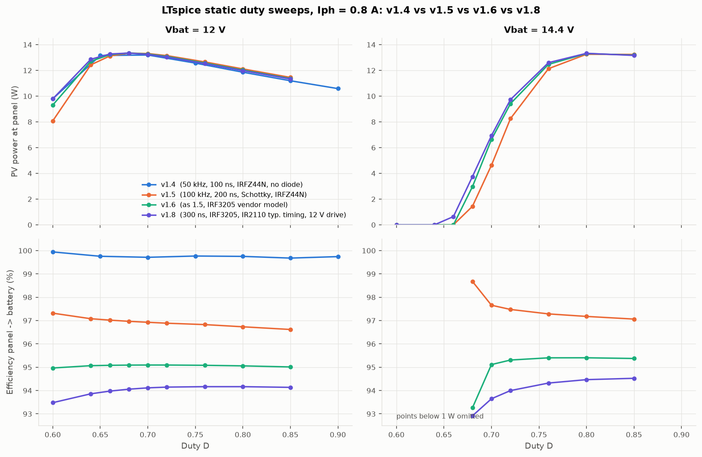

**Explanation.** The peak is in the same place in both versions: the panel operates near 17.9 V, which is the model's Vmp. v1.5 reports a slightly different best duty and a higher peak power for two reasons. First, v1.4 sampled only 0.65 and 0.70, both on the shoulders of the peak, so it caught only 98.8 % of the true maximum. Second, the Schottky adds ~0.3 V between the panel and the converter: the converter input is now about Vpv − 0.3 V, so the duty that puts the panel at Vmp shifts. With the 14.4 V battery the MPP moves to D ≈ 0.80, because Vin = Vbat/D, which is why D_max = 0.85 must stay above it. Below D ≈ 0.66 at 14.4 V the converter would need more than Voc at its input. In v1.4 that region gave negative power: current flowing back into the panel. **In v1.5 the Schottky blocks it.** The panel sits at Voc (21.19 V) with essentially zero current. The >100 % efficiency entries at D = 0.60–0.66, 14.4 V are ratios of near-zero numbers (mW of losses), not real.

**Efficiency drop (99.7 % → 97.0 %).** About 0.25 W (1.9 %) is the Schottky conduction loss: 0.33 V at 0.76 A. The rest (about 1 %) comes from doubling both fsw and dead time. The body diode now conducts during 2 × 200 ns of every 10 µs period, 4 % of the time instead of 1 %, and the switching losses double with frequency. Both efficiency figures are still optimistic. The gate sources are ideal 10 ns edges, the IRFZ44N stands in for the IRF3205 (which has a higher Qg, 146 nC max), and there is no inductor core/ESR loss or gate-driver loss.

### 2.3 Waveforms at D = 0.70 and 0.85

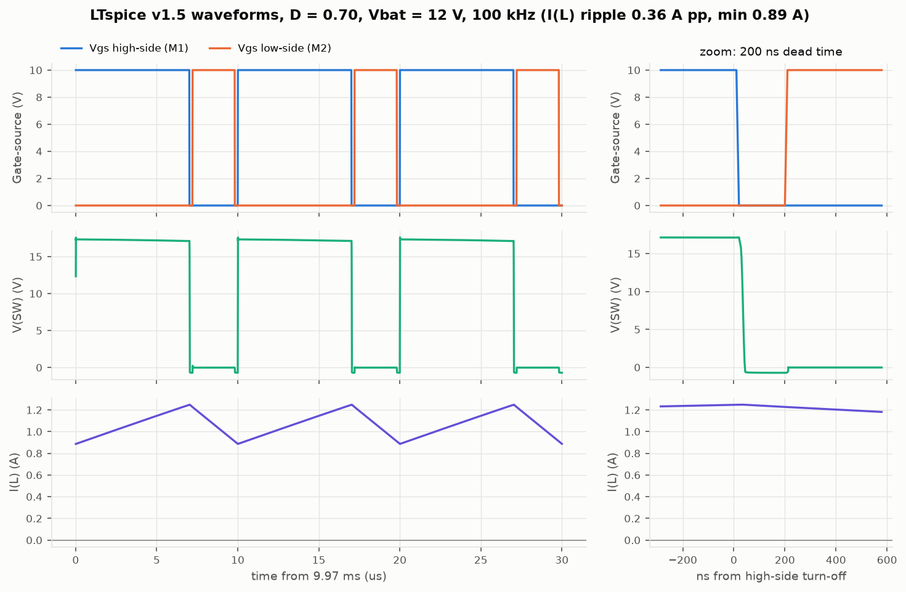

**D = 0.70, 12 V.** The two gate-source voltages never overlap. The zoom shows the 200 ns gap after high-side turn-off, during which V(SW) sits at about −0.7 V because the low-side body diode carries the inductor current. Then M2 turns on and V(SW) rises to about 0 V. I(L) is a clean triangle, 0.89–1.25 A (0.36 A pp, matching the hand calculation `Vout(1−D)/(L·fsw)`). It never reaches zero, so this point is in CCM.

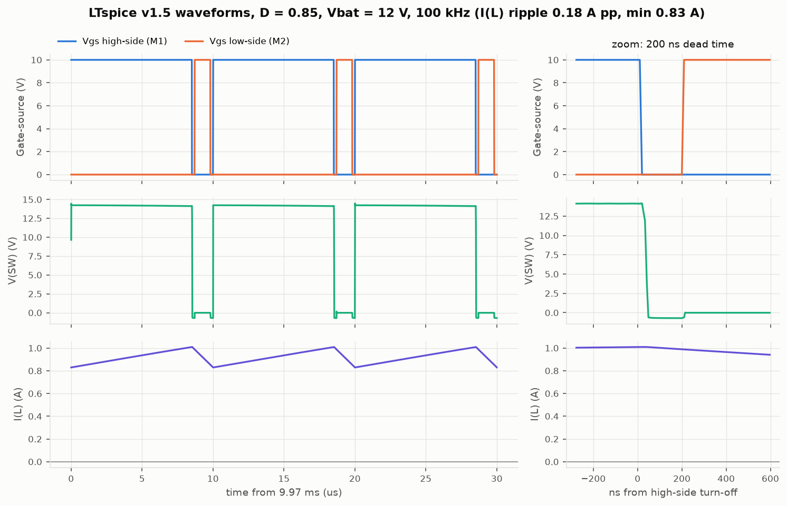

**D = 0.85, 12 V.** The low-side on-time is 0.15 × 10 µs − 2 × 200 ns = 1.1 µs, visible as the short orange pulses. That on-time is the time available to recharge the bootstrap capacitor on hardware. The ripple falls to 0.18 A pp because (1 − D) is smaller.

Also exported: `ltspice_v1.5_waveforms_D0.70_V14.4.png` and `..._D0.85_V14.4.png` (and the same four for v1.6). At 14.4 V and D = 0.70 the minimum I(L) is only +0.10 A. At D ≤ 0.68 it goes negative (−0.13 to −0.28 A, see `il_min` in the CSV). This is the **forced-CCM** behaviour of complementary PWM: the inductor current reverses instead of the converter entering DCM. The reverse current circulates between the battery and Cin; the Schottky keeps it out of the panel.

### 2.4 v1.6: real IRF3205 model

The user supplied the vendor subcircuit `irf3205.spi` (Infineon/IR, Symmetry MODPEX level-1 model, pins D-G-S, generated 2001). It is stored as `SimFiles/models/IRF3205.spi`. v1.6 is a copy of v1.5 with M1/M2 changed to this subcircuit (`Prefix X`, `.include models/IRF3205.spi`); nothing else changed.

**Model vs datasheet (`IRF3205.pdf` p.2):** Ciss in the model (CGSO·W) is 3.64 nF vs 3247 pF typ in the datasheet. In the waveform below, V(SW) starts falling ~50 ns after the turn-off command and the fall takes ~80 ns, close to the datasheet td(off) 50 ns + tf 65 ns typ (Rg = 4.5 Ω). The model's internal gate resistance is 3.97 Ω.

| | v1.5 (IRFZ44N), 12 V | v1.6 (IRF3205), 12 V | v1.6, 14.4 V |
|---|---|---|---|
| Best swept duty | 0.68 | 0.68 | 0.80 |
| Vpv there | 18.08 V | 17.93 V | 18.24 V |
| Ppv there | 13.339 W | 13.350 W | 13.308 W |
| Efficiency panel -> battery | 96.97 % | **95.09 %** | 95.40 % |
| Converter only (after diode) | 98.74 % | **96.85 %** | 97.13 % |
| I(L) at D = 0.70 | 0.36 A pp, min 0.88 A | 0.35 A pp, min 0.87 A | 0.41 A pp, min 0.23 A |

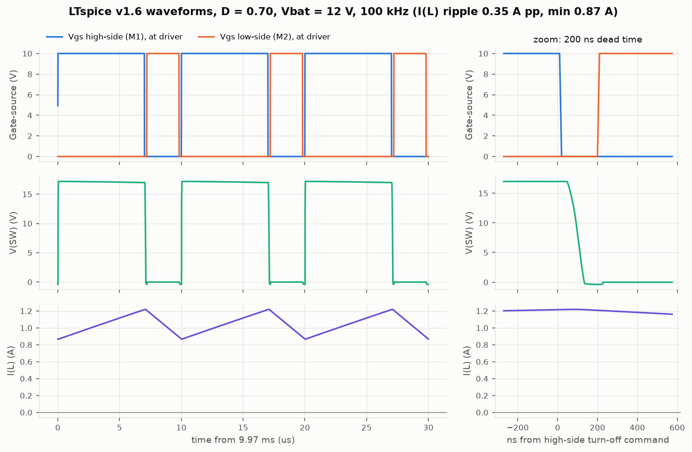

**What changed and why.**
- **The MPP is unchanged** (D = 0.68 at 12 V; panel 17.93 V, essentially the model's true Vmp of 17.92 V). The MOSFET model does not move the operating point, so the P&O design and the duty clamps are unaffected.
- **Turn-off is slower and uses more of the dead time.** With the IRFZ44N stand-in, V(SW) fell within ~40 ns. With the IRF3205 model it takes ~130 ns, so only ~60–70 ns of the 200 ns dead time is left with the body diode conducting (V(SW) ≈ −0.4 V). That margin assumes an ideal 10 V driver with no external gate resistor. The IR2110's own output resistance and any external Rg will slow turn-off further. **200 ns is adequate in the model, but the margin is not large; confirm on the scope before reducing it.**
- **The effective duty is slightly longer** (turn-off delay extends conduction), so at a given D slightly more current flows near the low-duty end (e.g. 14.4 V, D = 0.68: 2.96 W vs 1.44 W in v1.5). The 0.60 → 0.85 clamp range still contains the MPP at both battery voltages.
- **Converter efficiency falls 1.9 points (98.74 → 96.85 %)**, about 0.25 W more loss at the MPP. A sensitivity run shows this is almost entirely body-diode **reverse recovery** of M2 when M1 turns on:

| Body-diode transit time TT in the model | Converter efficiency (D = 0.68, 12 V) | Panel → battery |
|---|---|---|
| 100 µs (as shipped by the vendor) | 96.85 % | 95.09 % |
| 2.3 ns (TT ≈ Qrr/IF from the datasheet: 143 nC / 62 A) | 98.90 % | 97.10 % |
| 0 (no recovery) | 98.93 % | 97.14 % |

With TT = 100 µs the model stores nearly all of the charge injected during the dead time (~0.87 A × 200 ns ≈ 170 nC) and recovers it at every M1 turn-on: ≈ 170 nC × 17.4 V × 100 kHz ≈ 0.3 W, matching the extra loss. The datasheet Qrr (143 nC) is specified at **62 A**; at ~1 A the real recovery charge should be far smaller. **The v1.6 efficiency is therefore a pessimistic bound and the TT = 2.3 ns figure an optimistic one; the real converter efficiency should lie between ~96.9 % and ~98.9 % (model only; no switching-loss detail from the IR2110, layout or inductor).** A bench efficiency measurement is the only way to settle it. Reproduce with `sh sim/ltspice/tt_sensitivity.sh`; the vendor model in `SimFiles/` is not modified.

**Effect on the SIL.** The SIL plant still uses η = 0.9874 from v1.5. Re-running runs a and c with η = 0.9685 (v1.6) changed steady-state tracking by < 0.05 % and the CC current by < 1 mA, because P&O tracks the *shape* of the power curve, not its absolute value. So the SIL conclusions hold for either model.

### 2.5 v1.7: IR2110 driver timing and gate resistor (dead-time margin)

**Why.** v1.6 drove the gates with ideal 10 V, 10 ns sources and still used ~130 ns of the 200 ns dead time for the IRF3205 turn-off. A real IR2110 has propagation delays and ~6 Ω output resistance, and a gate resistor is normally added. v1.7 checks whether 200 ns is still enough.

**What was added** (v1.7 = v1.6 + these; the vendor IRF3205 model is unchanged):
- **IR2110 timing** (`IR2110.pdf` p.3): turn-on delay 120 ns typ / 150 max, turn-off 94 typ / 125 max, delay matching 10 ns max. Output resistance ≈ VCC / I_O = 15 V / 2.5 A ≈ 6 Ω typ (7.5 Ω at the 2.0 A minimum). Two corners:
  - *typical:* on 120 ns, off 94 ns, 6 Ω.
  - *pessimistic:* off 125 ns, on **assumed** 94 ns (the datasheet gives no minimum turn-on delay), 7.5 Ω.
- **Gate supply** VCC = 12 V (**PROPOSED**; datasheet range 10–20 V).
- **External gate network** in `SimFiles/models/gate_net_irf3205.sub` (project file, wraps the unmodified vendor model):
  - *symmetric:* Rg for both turn-on and turn-off, Rg = 0 / 4.7 / 10 / 22 Ω.
  - *split:* Rg for turn-on, 1 Ω + 1N5819 diode for turn-off.
- **Metric:** at each edge, the time from the outgoing FET's *internal* gate (node 7 of the vendor model, after its 3.97 Ω) falling below Vth = 3.73 V to the incoming FET's internal gate rising above it, plus the total time per cycle with both above Vth ("overlap" = shoot-through). Computed by `sim/ltspice/analyze_v17.py` from the `.raw`.

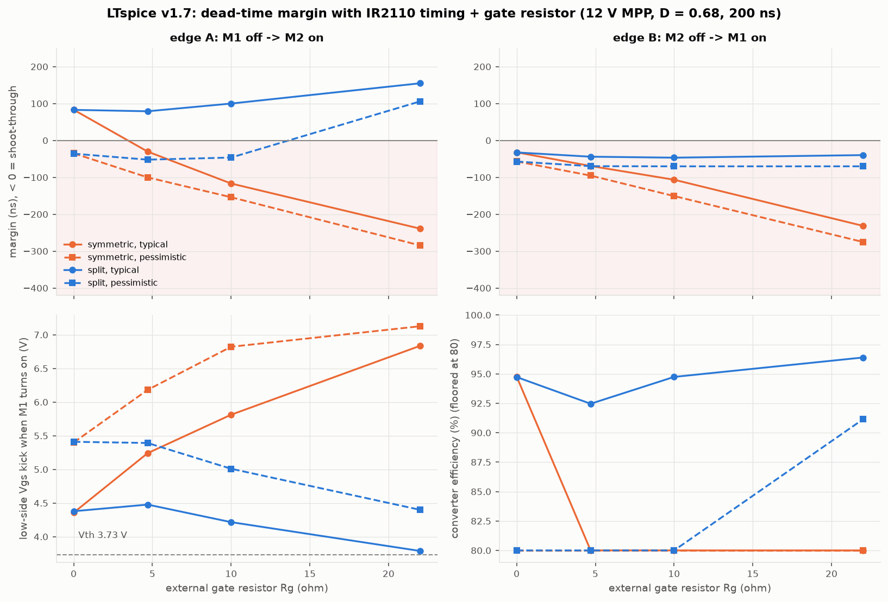

**Result 1: with the real driver, 200 ns is not enough in this model.** Even with no external gate resistor and typical IR2110 timing, there is ~22 ns of overlap per cycle at edge B (low side off → high side on), costing ~2 points of efficiency (94.8 % vs 96.9 % in v1.6). With the pessimistic corner it is 86 ns. Symmetric gate resistors make it much worse: at 10 Ω or more the converter stops working in the model (efficiency negative, the battery current reverses).

**Result 2: the main mechanism is a Miller kick, not just the delay.**

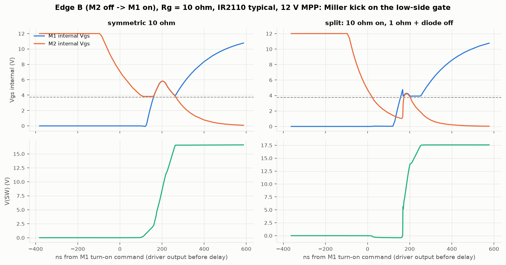

When M1 turns on, the switch node rises ~17 V in tens of ns. That edge couples through M2's gate-drain capacitance and pushes M2's gate *up* while the driver is holding it low (right plot: from ~1 V to 4.3 V, above Vth). The kick lands on whatever voltage is still left on M2's gate, so it is worse when the gate has not finished discharging (left plot, symmetric 10 Ω: M2's gate is still on a ~3.8 V plateau when M1 starts). Re-running the key cases with the datasheet-scaled body-diode TT (2.3 ns) gave the same kick (4.44 V vs 4.36 V), so it is a gate-capacitance effect, not a by-product of the pessimistic diode recovery.

**Result 3: what removes the overlap in the model** (`sim/ltspice/deadtime_sweep.sh`, Rg = 0, 12 V MPP, results in `ltspice_v1.7_deadtime_sweep.csv`):

| Dead time | IR2110 corner | Gate-source cap (both FETs) | Overlap per cycle | Low-side Vgs kick | Converter eff. |
|---|---|---|---|---|---|
| 200 ns (decided) | typical | none | **22 ns** | 4.37 V | 94.7 % |
| 200 ns | pessimistic | none | **86 ns** | 5.41 V | 68.5 % |
| 300 ns | typical | none | 9 ns | 3.88 V | 95.8 % |
| 300 ns | typical | 2.2 nF | **0** | 3.60 V | 95.9 % |
| 300 ns | pessimistic | 2.2 nF | 19 ns | 4.10 V | 96.0 % |
| 400 ns | typical | 2.2 nF | **0** | 3.38 V | 94.8 % |
| 400 ns | pessimistic | 2.2 nF | **0** | 3.55 V | 95.6 % |

- A longer dead time helps because the low-side gate has more time to discharge before the kick arrives.
- A small external gate-source capacitor helps because it forms a divider with the gate-drain capacitance, so the same edge produces a smaller kick.
- **300 ns + 2.2 nF** clears it at typical timing; **400 ns + 2.2 nF** also clears the pessimistic corner.
- The split gate network helps edge A a lot (+80 to +155 ns margin) but does not fix edge B on its own.
- **Decision (user, 2026-11-11): dead time changed to 300 ns.** The 2.2 nF gate-source capacitor and the split network remain PROPOSED (PCB pads, fitted if the scope shows a kick).

**Cost.** The 300 → 400 ns efficiency drop in the table (~1 point) is mostly the vendor model's pessimistic body-diode storage, which grows with conduction time. By the simple estimate (0.7 V × 1 A for an extra 2 × 100 ns per 10 µs) it should be ~0.1 %. The D_max low-side on-time shrinks to 0.9 µs at 300 ns and 0.7 µs at 400 ns, both still enough for bootstrap refresh in principle.

**How much to trust this.**
- The level-1 MOSFET model conducts tens of amps only ~0.6 V above Vth and has a sharp threshold, so the *size* of the shoot-through current and loss is probably exaggerated.
- The model's gate-drain capacitance has not been checked against the datasheet Crss curve.
- The pessimistic corner relies on an assumed minimum turn-on delay.
- There is no PCB source/gate inductance (which in real boards usually makes this *worse*).
- The driver is only delays plus a resistor.

The direction of the result is the well-known one: a hard-switched half-bridge with a ~6 Ω driver and high-Ciss FETs is prone to Miller turn-on. The exact numbers need the scope.

### 2.6 v1.8: duty sweep at the decided 300 ns

v1.8 is v1.7 set to the decided configuration and run as the usual duty sweep: dead time **300 ns**, IR2110 typical timing (on 120 ns, off 94 ns, ~6 Ω), 12 V gate supply (PROPOSED), no external gate resistor, **no** gate-source capacitor (still PROPOSED), IRF3205 vendor model, PV Schottky; duty 0.60–0.85 at 12 V and 14.4 V. Shoot-through per step comes from `sim/ltspice/overlap_report.py 1.8` (`ltspice_v1.8_overlap.csv`); sweep data in `ltspice_v1.8_sweep.csv`.

| | v1.6, 12 V (200 ns, ideal drive) | **v1.8, 12 V (300 ns, IR2110)** | v1.8, 14.4 V |
|---|---|---|---|
| Best swept duty | 0.68 | **0.68** | 0.80 |
| Ppv there | 13.350 W | **13.346 W** | 13.327 W |
| Efficiency panel → battery | 95.09 % | **94.06 %** | 94.47 % |
| Converter only | 96.85 % | **95.81 %** | 96.19 % |
| Shoot-through overlap per cycle | (ideal drive) | **9.5 ns** | 8.5 ns |

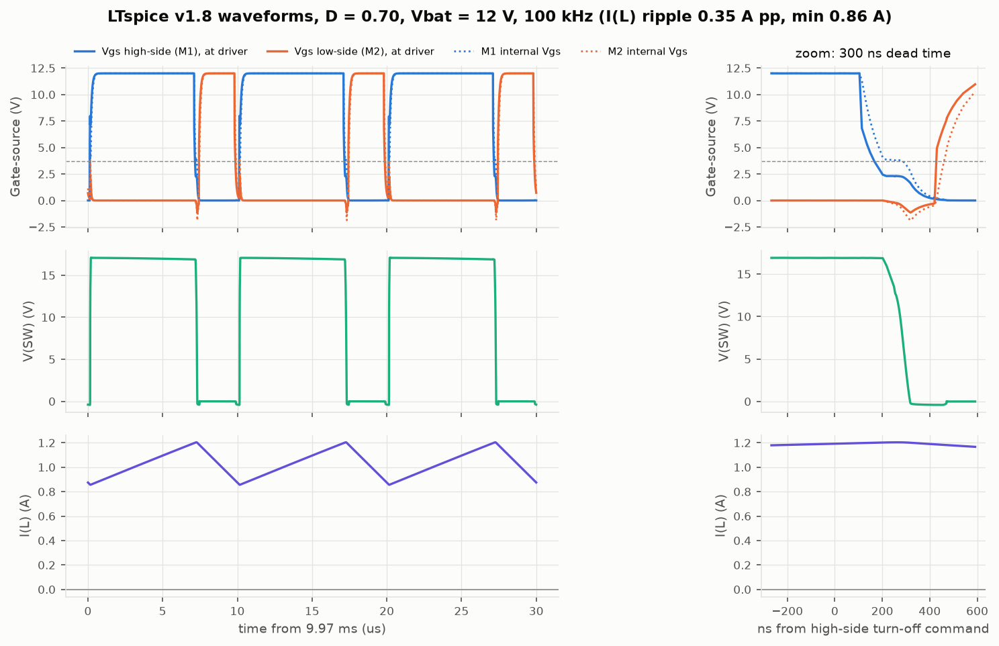

- **The MPP does not move** (D = 0.68 at 12 V, 0.80 at 14.4 V), so the P&O design, the duty clamps and the SIL results are unaffected by the dead-time change.
- **Edge A is comfortable:** +175 to +250 ns margin at every duty. In the zoom, the high-side gate holds its Miller plateau (~3.8 V internal) for ~200 ns after the command before switching off, and the low side comes on ~175 ns later.
- **Edge B still shows a small residual overlap:** 6–14 ns per cycle wherever the converter delivers power, except at 12 V with D ≥ 0.76. The low-side Miller kick peaks at 3.8–4.0 V, just above the 3.73 V threshold. This is the same result as v1.7's 300 ns row (9 ns). v1.7 showed that a 2.2 nF gate-source capacitor removes it (0 ns, converter 95.9 %), which is why the capacitor pads stay recommended.
- **Efficiency at the 12 V MPP is 94.1 % panel → battery (95.8 % converter only).** Compared with v1.6 (95.1 % / 96.9 %, ideal drive at 200 ns), the extra ~1 point comes from the residual overlap, the longer body-diode conduction (amplified by the vendor model's pessimistic diode storage, §2.4) and the real gate drive. The quoted range from §2.4 still applies in spirit: the true figure depends mostly on the body-diode behaviour and on the residual Miller kick, and only the bench can settle it.

---

## 3. Firmware logic (`firmware/`)

| File | Contents |
|---|---|
| `mppt_po.h/.c` | `po_state_t`, `po_init()`, `po_update()` exactly as in PROJECT_STATE §3.3 |
| `charger_fsm.h/.c` | `charge_state_t`, `meas_t`, `fsm_step()` (§3.3 signature, pure function) plus `charger_cfg_t`, `charger_t`, `charger_init()`, `charger_update()` (transition + per-state duty action) |

**Sign convention** (stated in `mppt_po.h`): the battery clamps the output, so Vpv ≈ Vbat/D. *Increasing D lowers the PV voltage.* `dir = +1` means the next step increases D.

**What P&O tracks.** The only current sensor is the INA219 on the charge path, so P&O maximises **output** power Vbat · Ibat. This tracks the panel MPP as long as converter efficiency is nearly flat near the MPP. In v1.5 `eff_conv` varies by only 0.06 % (98.72–98.78 %) between D = 0.64 and 0.72, so the assumption holds in the model.

**Regulators.** In CC_LIMIT, CV_ABSORB and FLOAT the duty is integrated: D += K·error, limited to 8 counts per period. CV and FLOAT use `min(voltage term, current term)`, so the current limit still applies during absorption. These loops assume the operating point is on the high-voltage side of the MPP, where more duty means more current. If the panel can no longer supply the target, the exits back to BULK_MPPT stop the integrator from winding past the MPP.

**Where to measure Vpv.** It must be measured on the **panel side** of the Schottky. At night, complementary PWM runs the buck backwards (boost from battery into Cin), so the converter-side node is pumped to about Vbat/D, which is above Vbat. A divider there would never see the panel collapse. `Ibat < −0.2 A → IDLE` is a second, independent check.

**Compilation (2026-11-11).**

| Compiler | Flags | Result |
|---|---|---|
| MSYS2 UCRT64 gcc 16.2.0 (host) | `-std=c99 -O2 -Wall -Wextra -Wpedantic -Wdouble-promotion -Wconversion -Wshadow` | 0 warnings |
| arm-none-eabi-gcc 14.3.1 (STM32CubeIDE 2.1.1 bundle) | `-mcpu=cortex-m4 -mthumb -mfpu=fpv4-sp-d16 -mfloat-abi=hard -O2` + the warnings above | 0 warnings; `.text` 188 B (P&O) + 1104 B (FSM); FPU instructions (`vmul`, `vadd`, …), no soft-float library calls |

Not done: no `main.c`, startup file or linker script, so no `.elf`, and nothing has been run on the Nucleo. These objects show the logic compiles for the target; they are not a flashed build.

---

## 4. Software-in-the-loop

### 4.1 Setup

- **Controller:** `firmware/mppt_po.c` and `firmware/charger_fsm.c`, unchanged, built into `sim/sil/build/libcharger.dll` and called from Python through `ctypes` every 20 ms. A shim (`sil_shim.c`) reports `sizeof` of each struct so Python checks its struct layouts match the compiler's.
- **PV model:** same single-diode model as LTspice (Iph source, Is = 1 nA, N = 40, Rs = 0.35 Ω, Rsh = 1500 Ω, 27 °C). Irradiance is represented by scaling Iph.
- **Schottky:** same MBRS340 diode equation as LTspice.
- **Converter:** averaged CCM buck. Vin_conv = Vbat_terminal / D, output power = η · input power, with **η = 0.9874** read from the LTspice v1.5 CSV (converter-only efficiency at the 12 V MPP). Duty is quantised to whole TIM1 counts (round(D·420)/420) as on hardware.
- **Quasi-static assumption:** each 20 ms period is solved as a DC operating point. The L/C dynamics are assumed settled within a period. LTspice settles from a cold start well inside the 8 ms before its measurement window, so this is reasonable for a 20 ms control period, but SIL cannot show sub-period transients.
- **Battery:** capacitor Cb + series Rb = 0.08 Ω (same R as LTspice), plus an optional constant 50 mA IoT load. For runs a, b, c, e, Cb = 10⁹ F (fixed voltage, like LTspice). For run d, **Cb = 10 F**. A real 2.2 Ah SLA spans roughly 1.8 V of OCV over its charge range, i.e. C_eq ≈ 7920 C / 1.8 V ≈ 4400 F. So **1 s of simulated time ≈ 440 s real** in run d.
- **Cross-check of the plant against LTspice v1.5** (Iph = 0.8 A):

| Vbat, D | LTspice Vpv / Ppv | SIL Vpv / Ppv |
|---|---|---|
| 12 V, 0.70 | 17.58 V / 13.309 W | 17.59 V / 13.313 W |
| 12 V, 0.85 | 14.53 V / 11.456 W | 14.53 V / 11.458 W |
| 14.4 V, 0.80 | 18.39 V / 13.253 W | 18.41 V / 13.243 W |
| 14.4 V, 0.64 | 21.19 V / 0 W | 21.19 V / 0 W |
| 12 V, 0.60 | 20.32 V / 8.08 W | 20.37 V / 7.75 W (−4 %: steep part of the curve near Voc, where dead-time effects on the effective duty matter) |

Results: `sim/sil/results/*.png`, `sil_summary.csv` (one row per run/segment), `run_log.txt`.

### 4.2 Run a: irradiance step 0.8 → 0.5 → 0.8 A

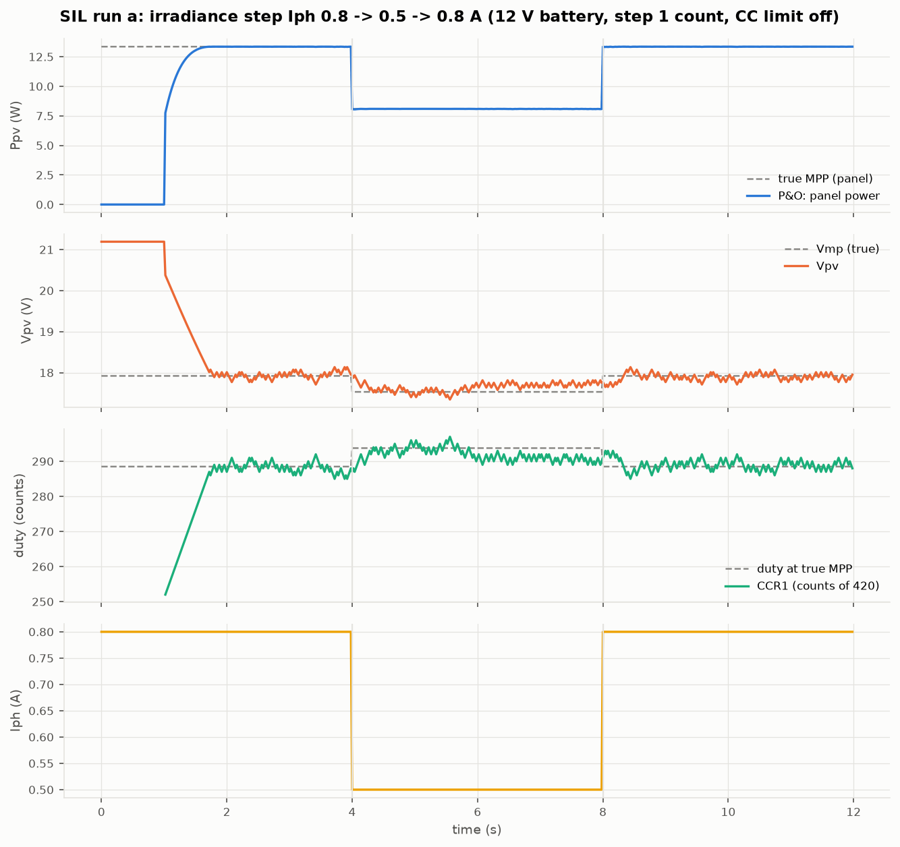

Battery fixed at 12 V; step 1 count; CC limit moved to 2 A so only MPPT acts (all other protections active). At t = 0 the FSM is in IDLE with the panel at Voc. After the 1 s restart hold-off it starts at D0 = Vbat/Vpv, clamped to 0.60 (252 counts), where the converter draws little current. P&O then climbs 1 count per 20 ms and reaches the MPP duty about 0.7 s later. The irradiance steps barely move the MPP voltage (17.9 V → 17.5 V): Vmp of a single-diode panel depends only logarithmically on Iph. So the operating point stays within 0.6 % of maximum power the instant the step happens (worst Ppv/Pmax in the first second: 99.45 %). The tracker re-centres within 0.14–0.26 s. Steady-state tracking efficiency (mean Ppv/Pmax over the last 2 s of each segment): **99.98 % / 99.89 % / 99.98 %**.

### 4.3 Run b: step size 1 / 2 / 4 counts

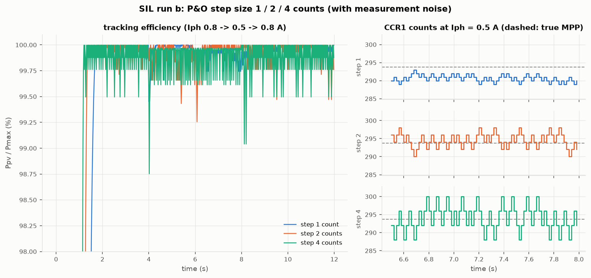

| Step | Settle from IDLE (incl. 1 s hold-off) | Steady-state Ppv/Pmax, with noise (0.8 / 0.5 / 0.8 A) | Duty dither pp, with noise | Without noise: Ppv/Pmax / dither pp |
|---|---|---|---|---|
| 1 count | 1.72 s | 99.98 / 99.89 / 99.98 % | 4–7 counts (0.24–0.43 V) | 99.99 % / 2 counts (0.12 V) |
| 2 counts | 1.38 s | 99.95 / 99.93 / 99.93 % | 10–12 counts (0.6–0.7 V) | 99.98 % / 4 counts |
| 4 counts | 1.20 s | 99.89 / 99.88 / 99.88 % | 12 counts (0.7 V) | 99.88–99.91 % / 8 counts |

**Explanation.** Without noise, P&O does the textbook thing: a 3-level limit cycle of ±1 step around the MPP. The loss grows with step size (99.99 % → 99.9 %), and the start-up gets faster because the tracker covers ~36 counts in fewer periods. This supports the "1 count to minimise oscillation loss" design choice. With noise the picture changes. Near the MPP a 1-count move changes power by only about 3.5 mW per count of distance from the peak (from the LTspice curvature, d²P/dD² ≈ −630 W per unit duty²). The noise on the measured power difference is about 18 mW, dominated by 1 mA of current noise × 12 V. So within ±4 counts of the peak P&O cannot tell which way is uphill and random-walks (see the right-hand panel: step 1 wanders below the MPP for this 1.5 s window). Larger steps give a bigger ΔP per step and sense direction better, but they dither more on purpose. The net effect is small: every step size stays above 99.88 % **in this model**, because the P-V curve is very flat at the top. Two practical conclusions:
- Measurement noise, not step size, sets the steady-state accuracy. Averaging the INA219 (more samples per 20 ms) would help more than changing the step.
- The SIL power loss differences (≤ 0.1 %) are smaller than the plant model's uncertainty. Report them as a trend, not as a precise number.

### 4.4 Run c: full sun (CC limit) vs partial sun (MPPT)

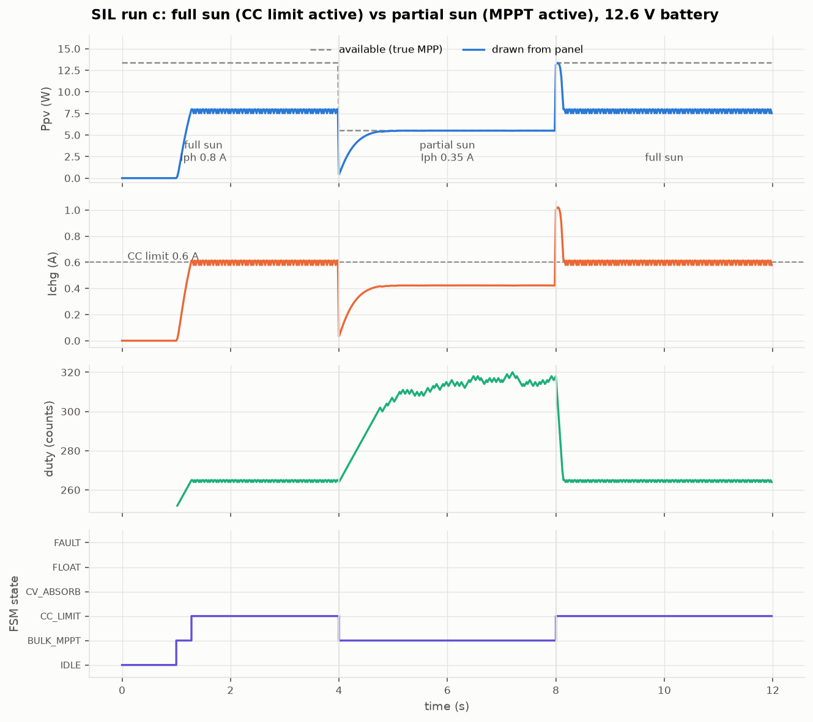

Battery fixed at 12.6 V, default configuration (CC limit 0.6 A). At full sun (Iph 0.8 A) the panel could deliver about 13.3 W, i.e. ~1.0 A at 12.6 V. The FSM moves to CC_LIMIT after 0.3 s of BULK and holds **0.600 A** on average. That draws only 58 % of the available power: the charger deliberately operates to the right of the MPP (higher Vpv, lower D). This confirms PROJECT_STATE §4.1 item 4: **in full sun the CC limit, not MPPT, is the active mode.** At partial sun (Iph 0.35 A) the available current is below 0.51 A (0.85 × I_CC), so the FSM returns to BULK_MPPT and tracks at 99.95 %. When full sun returns at 8 s, the duty is far to the left of the new MPP. The current briefly rises to 1.0 A for ~150 ms while the CC integrator walks the duty back through the MPP. This is below the 1.5 A fault threshold but above the battery limit. Treat it as a known transient of an instant 0.35 → 0.8 A step (real clouds clear over seconds); hardware should confirm it. In CC the current dithers about ±20 mA: one TIM1 count is worth about 21 mA at this operating point (quantisation limit cycle; the average is exact).

### 4.5 Run d: CC → CV → taper → float

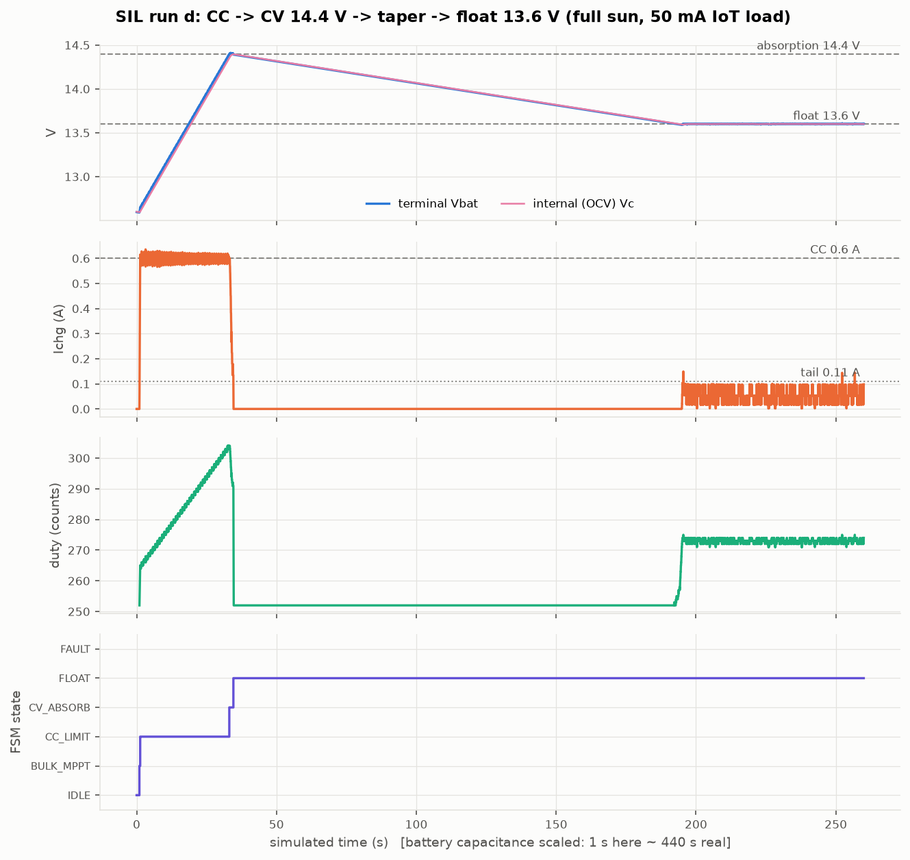

Full sun, 50 mA IoT load, battery starting at 12.6 V, Cb = 10 F (1 s ≈ 440 s real).
- **0–1.3 s:** IDLE hold-off, then BULK.
- **1.3–33.1 s:** CC_LIMIT at 0.6 A. The battery voltage rises linearly, as a capacitor model must.
- **33.1 s:** Vbat reaches 14.4 V → CV_ABSORB. The current tapers as the internal voltage approaches 14.4 V (peak terminal voltage 14.41 V).
- **34.6 s:** Ichg < 0.11 A → FLOAT. The internal voltage is still ~14.39 V, above 13.6 V, so the regulator drives the duty to D_min and the charger delivers nothing. The IoT load slowly discharges the battery.
- **~195 s:** terminal voltage reaches 13.6 V. The float regulator takes over and holds **13.600 V** (mean of the last 20 s), supplying 49 mA, i.e. the load.

The float current dithers 0.02–0.10 A. Here the converter works near Voc (13.6 V / D ≈ 20.9 V), where the P-V curve is steep: one count changes the current by ~87 mA, so ±1 count is the best 420-count resolution can do. The first SIL run used K_V = 0.5: the loop gain at this point was ~1.5 and the duty swung 0–0.24 A, near-oscillation driven by measurement noise. K_V was reduced to 0.10 (loop gain ~0.3) and the run repeated. **The absorption taper lasts only 1.5 s of sim time (~11 min real).** A real SLA tapers over hours, because its internal resistance and polarisation are far larger than a single 0.08 Ω. That part of the plot shows the *FSM sequence* is correct; it does not show realistic timing.

### 4.6 Run e: panel collapse (night) and a latched fault

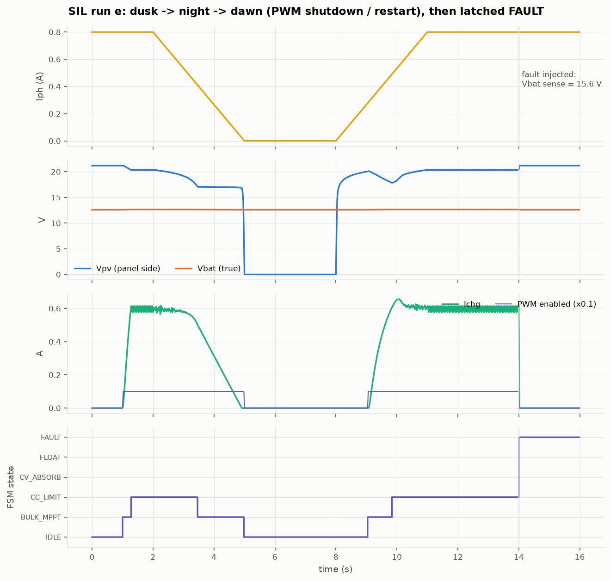

Battery fixed at 12.6 V.
- **Dusk:** Iph ramps 0.8 → 0 A over 2–5 s. The charger goes CC → BULK (at 3.4 s, when the panel can no longer supply 0.51 A). It tracks down to near zero power, then at **t = 4.98 s, Iph = 5 mA**, the panel voltage collapses below Vbat + 0.3 V and the FSM shuts the PWM off (IDLE).
- **Night:** Vpv = 0 and there is no switching.
- **Dawn:** from 8 s the unloaded panel voltage rises above Vbat + 1 V. After the 1 s hold-off the converter restarts **once**, at 9.04 s, with no start-stop chatter, and moves to CC when the current reaches 0.6 A. The current overshoots to 0.69 A while irradiance is still ramping, then settles.
- **Fault:** at 14 s the battery-voltage measurement is forced to 15.6 V (stands in for a battery disconnect or sense fault). The FSM latches **FAULT (BAT_OV)** in the same period and the PWM stays off even though the sun is up. Only `charger_init()` (reset) clears it.

---

## 5. Limitations (read before quoting any number)

1. **PV model calibrated to Voc only.** Is, N, Rs and Rsh were chosen to give Voc ≈ 21 V. The Vmp ≈ 17.9 V and Pmax ≈ 13.35 W that follow are model outputs; Pmax is above the panel's 12 W rating. The panel datasheet (Isc, Imp) is still missing.
2. **Modeled battery.** LTspice uses an ideal voltage source plus 0.08 Ω. SIL uses a scaled capacitor plus 0.08 Ω. Neither has realistic SLA charge acceptance, polarisation, gassing or temperature dependence, and the scaled time compresses the absorption taper unrealistically (§4.5). The 0.6 A limit is derived from the 1.3 Ah sibling's datasheet, not the 2.2 Ah part.
3. **Averaged, quasi-static plant in SIL.** No switching ripple, no L/C transients inside a 20 ms period, constant converter efficiency, no forced-CCM reverse current (the Schottky is assumed to block everything). Measurement noise is assumed Gaussian with assumed σ. There is no ADC/INA219 timing, aliasing or I2C error in the loop.
4. **MOSFET and driver models in LTspice.** v1.5 used the IRFZ44N placeholder (optimistic). v1.6/v1.7 use the vendor IRF3205 model, whose body-diode recovery is pessimistic at ~1 A (§2.4) and whose level-1 channel exaggerates current near threshold (§2.5). v1.7 models the IR2110 only as datasheet delays plus an output resistance; bootstrap droop / UVLO at D_max and PCB inductance are not simulated.
5. **Untested on hardware.** The firmware logic compiles for the Cortex-M4F but has not run on the Nucleo. There is **no bench data**. All results here are simulated; none are validated.
6. **Untuned regulator parameters.** K_I, K_V, tail current, margins and the hold-off were chosen against this model. They are PROPOSED and must be re-tuned on the bench, where the battery's real resistance is much larger and changes the CV/float loop gain.

---

## 6. Open items from this simulation round

- **IRF3205 vendor SPICE model:** done in v1.6 (§2.4). Decided 2026-11-11: the vendor model stays unmodified; efficiency is quoted as the range in §2.4.
- **PWM resolution:** 420 counts (center-aligned) causes the ±21–87 mA CC/float limit cycles above. Edge-aligned TIM1 at 100 kHz would give 840 counts (PROPOSED). Center-aligned is otherwise attractive for symmetric ADC triggering, so this is a trade-off for the user to decide.
- **TIM1 dead-time register:** the PROJECT_STATE §3.2 draft now uses `DEADTIME_DTG 0x19` (297.6 ns) for the DECIDED 300 ns (was 0x28 = 476 ns).
- **Absorption timer:** CV → FLOAT currently depends only on the tail current. A minimum absorption time (or a timeout) is a common addition and is not implemented.
- **Dead time:** DECIDED 300 ns (user, 2026-11-11, after v1.7). Still PROPOSED: gate-source capacitor pads, split gate network, scope check of the low-side gate at bring-up. Duty sweep at 300 ns: v1.8 (§2.6), 6–14 ns residual overlap without the capacitor.
